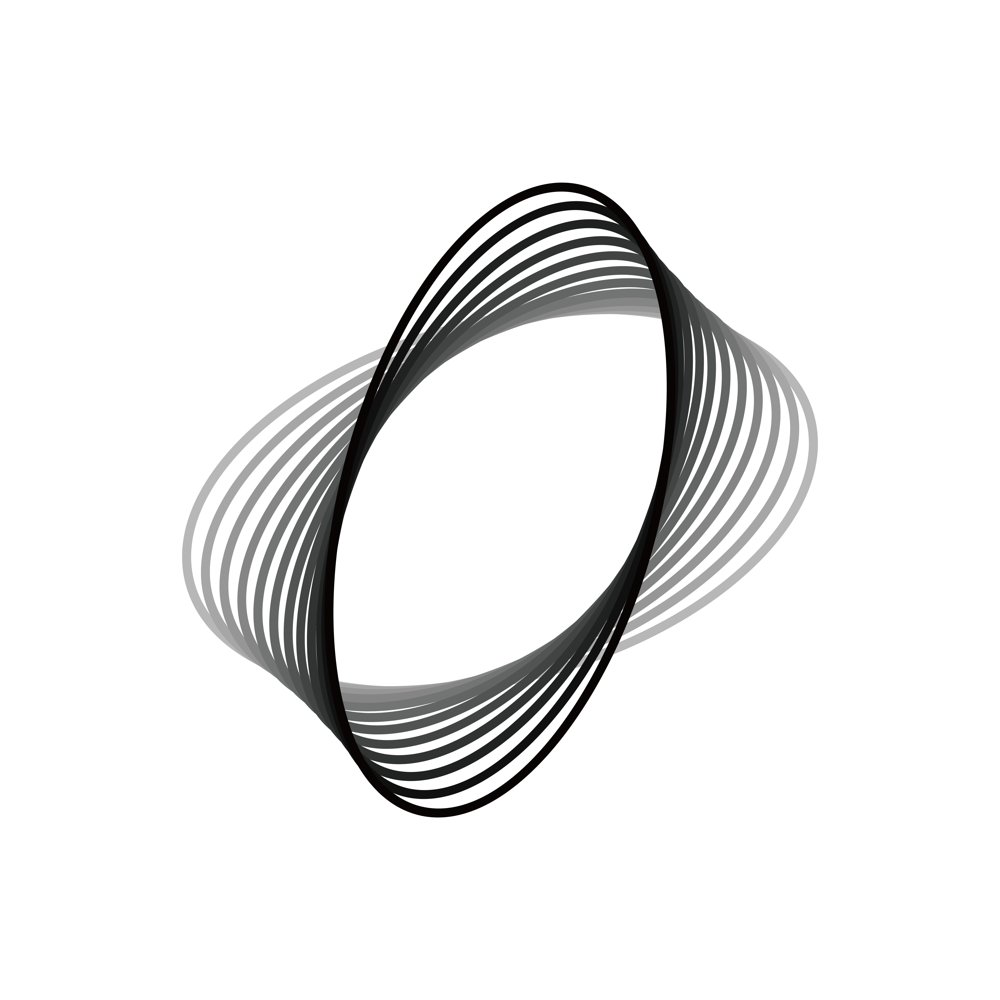

<p align="center"></p>
<h1 align="center">ZERITH 2.5</h1>
<p align="center"><strong>From Predictive Power to Policy Learnability</strong></p>
<p align="center">A video–action model for robot control</p>
<p align="center">
  <a href="https://zerith-25-review.kindpetal17.chatgpt.site/">📖 Research Blog</a> &nbsp;·&nbsp;
  <a href="https://zerith-25-review.kindpetal17.chatgpt.site/assets/ZERITH-2.5-v1.0.pdf">📄 Technical Report</a> &nbsp;·&nbsp;
  <a href="#model-zoo">🤗 Model Weights</a> &nbsp;·&nbsp;
  <a href="#quick-start">🚀 Quick Start</a>
</p>
<p align="center">
  <strong>English</strong> &nbsp;/&nbsp; <a href="README_zh-CN.md">简体中文</a>
</p>

<div align="center">

https://github.com/user-attachments/assets/1affaaa2-3db4-4007-8057-791f7171996b

</div>

## Overview

**ZERITH 2.5** is a video–action model for robot manipulation, with approximately
**6.774B trainable parameters** (excluding frozen visual, language and geometry
encoders). It uses multi-view observations, language instructions and robot state
to predict actions, drawing on the predictive features of a video generation model.

Our central question is: **when do video-generation priors help a robot learn to
act?** We study how predictive training affects subsequent action learning under
fixed demonstrations and a fixed total number of training updates. The controlled
experiments show that:

- **Target-domain predictive adaptation improves policy learnability.** Adapting the video model before joint video–action learning improves LIBERO-Plus success by **17.55–19.16 percentage points** across three geometry-conditioning settings, each evaluated with three training seeds.
- **The predictive supervision matters.** Adaptation across a broad range of noise levels yields a substantial gain; adaptation only at the pure-noise level used at deployment does not reproduce it.
- **The gain follows the adapted video model.** It persists when adapted weights remain in the video model, but disappears when those weights are used only to initialize the action policy.

See the [research blog](https://zerith-25-review.kindpetal17.chatgpt.site/) and
[technical report](https://zerith-25-review.kindpetal17.chatgpt.site/reader.html)
for the methodology, controlled studies and analysis.

## News

- **2026-11-04:** The [ZERITH 2.5 research preview](https://zerith-25-review.kindpetal17.chatgpt.site/) presents the model, benchmark results and real-robot demonstrations.

## Benchmark Results

### Simulation Benchmarks

| Benchmark | ZERITH 2.5 | π₀ | π₀.₅ | OpenVLA-OFT | Fast-WAM | Cosmos Policy |
| :--- | :---: | :---: | :---: | :---: | :---: | :---: |
| [LIBERO](docs/simulation/libero.md) | **98.95%** | 94.20% | 96.90% | 97.10% | 97.60% | 98.50% |
| [LIBERO-Plus](docs/simulation/libero-plus.md) | **93.70%** | 53.60% | 85.70% | 69.60% | 49.14% | 82.20% |
| [MetaWorld MT50](docs/simulation/metaworld.md) | **92.3%** | 47.9%† | 81.6%† | — | — | — |

All values are task success rates. These are the report's **complete-system**
results; baseline values retain their source-specific evaluation protocols.
† MetaWorld baselines average the four difficulty-group success rates equally,
whereas ZERITH 2.5 pools successes over evaluation episodes. See
[Tables 4–5](https://zerith-25-review.kindpetal17.chatgpt.site/reader.html#page=12)
for model variants, task coverage and comparison conditions. A dash indicates an
unreported result. Click a benchmark name for the evaluation guide.

### Real-Robot Evaluation and Demos

| H1 task | Trials per model | ZERITH 2.5 | π₀.₅ | Fast-WAM |
| :--- | :---: | :---: | :---: | :---: |
| Pick and place | 100 | **97%** | 95% | 84% |
| Bin lining | 20 | **40%** | 35% | 15% |
| Bimanual assembly | 20 | **10%** | **10%** | 0% |

Success rates are from
[Table 6](https://zerith-25-review.kindpetal17.chatgpt.site/reader.html#page=14).
Watch the [demonstration clips](https://zerith-25-review.kindpetal17.chatgpt.site/#real-world)
for bin lining, SKU sorting and bimanual assembly. Playback speeds are marked
on the clips; SKU sorting is a qualitative demonstration.

## Model Zoo

The following **ZERITH 2.5** checkpoints cover the three simulation benchmarks
and the H1 platform.

| Model | Description | Checkpoint | Guide |
| :--- | :--- | :---: | :---: |
| **ZERITH 2.5 · LIBERO** | LIBERO inference and evaluation | [🤗 Hugging Face](https://huggingface.co/OpenZerith/ZERITH-2.5-LIBERO) | [Guide](docs/simulation/libero.md) |
| **ZERITH 2.5 · LIBERO-Plus** | LIBERO-Plus inference and evaluation | [🤗 Hugging Face](https://huggingface.co/OpenZerith/ZERITH-2.5-LIBERO-Plus) | [Guide](docs/simulation/libero-plus.md) |
| **ZERITH 2.5 · MetaWorld** | MetaWorld MT50 inference and evaluation | [🤗 Hugging Face](https://huggingface.co/OpenZerith/ZERITH-2.5-MetaWorld) | [Guide](docs/simulation/metaworld.md) |
| **ZERITH 2.5 · H1** | H1 mid-training backbone checkpoint | [🤗 Hugging Face](https://huggingface.co/OpenZerith/ZERITH-2.5-H1) | [Guide](#h1-deployment) |

The Hub repositories require authorized access. Simulation policies use FP32;
the quick-start download script also obtains their required encoders.

## Quick Start

Evaluate the released **LIBERO-Plus** checkpoint on tasks **0, 30 and 60**
from `libero_spatial`, one episode each, with seed 0. No training or demonstration
dataset is needed. Every required step is included below; run each terminal's
commands from the source repository root.

Requirements: Linux, Conda, an NVIDIA driver compatible with CUDA 12.8 PyTorch,
and Hugging Face access to the model repository. The FP32 policy weights alone
occupy about 27 GB; an 80 GB GPU is recommended to allow room for encoders and runtime.

### 1. Install the Base Environment

On Ubuntu/Debian, install system libraries first; omit `sudo` when running as root:

```bash
sudo apt-get update
sudo apt-get install -y git curl

git clone https://github.com/inFpZero/ZERITH-2.5.git
cd ZERITH-2.5
sudo bash scripts/install_libero_system_deps.sh
conda create --override-channels -c conda-forge -n zerith-inference python=3.12 pip -y
conda activate zerith-inference
python -m pip install torch==2.10.0 torchvision==0.25.0 --index-url https://download.pytorch.org/whl/cu128
python -m pip install -r simulation/requirements-inference.txt
```

### 2. Download All Required Assets

Run in the `zerith-inference` environment:

```bash
bash scripts/download_libero_plus_assets.sh
```

The script downloads the policy, Wan/VGGT sources and weights, simulator sources
and assets, and exports the 40 base instructions under `simulation/assets/`.
It reuses your saved Hugging Face login or `HF_TOKEN`, prompting for login if
needed. Repeated runs reuse downloaded content and preserve local edits.

### 3. Configure the Simulator Environment

```bash
python scripts/configure_libero.py --benchmark-root simulation/assets/LIBERO-plus \
  --config-dir simulation/assets/libero-plus-config \
  --asset-archive simulation/assets/libero-plus-download/assets.zip
conda create --override-channels -c conda-forge -n zerith-libero-plus python=3.10 pip -y
conda run --no-capture-output -n zerith-libero-plus python -m pip install 'setuptools<82'
conda run --no-capture-output -n zerith-libero-plus python -m pip install torch==2.5.1 torchvision==0.20.1 --index-url https://download.pytorch.org/whl/cpu
conda run --no-capture-output -n zerith-libero-plus python -m pip install \
  -c simulation/constraints-libero-client.txt -r simulation/assets/LIBERO-plus/requirements.txt \
  -r simulation/assets/LIBERO-plus/extra_requirements.txt 'requests>=2.32'
conda run --no-capture-output -n zerith-libero-plus python -m pip install --no-deps -e simulation/assets/LIBERO-plus
```

The configuration tool verifies the asset SHA256, normalizes the archive's
directory layout and writes an isolated LIBERO-Plus configuration. CPU PyTorch
is used only by simulator dependencies; policy inference remains in the GPU environment.

### 4. Start the Policy Service

In terminal 1, start the service from the repository root and leave it running:

```bash
conda run --no-capture-output -n zerith-inference --cwd simulation python -m zerith_sim.posttrain serve --artifact assets/policies/libero-plus \
  --base-instructions assets/libero-instructions.json \
  --wan-repo assets/Wan2.2 --wan-model assets/Wan2.2-TI2V-5B \
  --vggt-repo assets/vggt --vggt-model assets/VGGT-1B --device cuda:0 --port 8000
```

### 5. Run the Quick Evaluation

In terminal 2, enter the same source repository root and run. The health check
waits up to ten minutes for the model service to finish loading:

```bash
export MUJOCO_GL=egl
export LIBERO_CONFIG_PATH="$PWD/simulation/assets/libero-plus-config"
curl --fail --retry 120 --retry-delay 5 --retry-connrefused --retry-max-time 600 \
  http://127.0.0.1:8000/health
conda run --no-capture-output -n zerith-libero-plus --cwd simulation python -m zerith_sim.posttrain eval --bench libero-plus --benchmark-root assets/LIBERO-plus \
  --suite libero_spatial --task-ids 0 30 60 --episodes 1 --seed 0 \
  --server http://127.0.0.1:8000 --output results/libero-plus-quickstart
```

`/health` should identify `libero-plus`. At completion, the client prints
**`EVAL_SUMMARY`** and writes these files under
`simulation/results/libero-plus-quickstart/`:

| File | Contents |
| :--- | :--- |
| `episodes.jsonl` | Task ID, episode ID, success flag and steps for each trial |
| `summary.json` | Selected tasks, seed, completed episodes, successes and success rate (0–1) |

This three-episode example checks closed-loop execution and does not reproduce
the full benchmark score. See the [complete LIBERO-Plus workflow](docs/simulation/libero-plus.md)
for full evaluation and training your own policy.

### Run on Intel GPU (XPU)

The released policies also run on Intel GPUs (for example Arc Pro B60)
with PyTorch for XPU. The FP32 policy does not fit on one Arc Pro B60 card, so load it in
BF16 with `--dtype bfloat16`; the encoders are unchanged. Install the XPU build
of PyTorch instead of the CUDA one in step 1:

```bash
python -m pip install torch torchvision --index-url https://download.pytorch.org/whl/xpu
python -m pip install -r simulation/requirements-inference.txt
```

Then start the service of step 4 with `--device xpu:0 --dtype bfloat16
--text-device cpu` (or `--text-device xpu:1` on a second card), or check
inference without a simulator:

```bash
python scripts/smoke_inference.py --target libero --artifact simulation/assets/policies/libero \
  --device xpu:0 --dtype bfloat16 --output results/smoke-xpu.json \
  --wan-repo simulation/assets/Wan2.2 --wan-model simulation/assets/Wan2.2-TI2V-5B \
  --vggt-repo simulation/assets/vggt --vggt-model simulation/assets/VGGT-1B
```

Training, the optional Hopper FlashAttention-3 kernel, the Triton kernels and
the H1 robot deployment remain CUDA-only.

## Simulation Evaluation and Training

Each benchmark has two complete workflows: **evaluate the released checkpoint**,
or **prepare demonstrations, train your own policy and evaluate it**.

| Benchmark | Complete workflow |
| :--- | :---: |
| LIBERO | [Download, evaluate, train and export](docs/simulation/libero.md) |
| LIBERO-Plus | [Download, evaluate, train and export](docs/simulation/libero-plus.md) |
| MetaWorld MT50 | [Download, evaluate, train and export](docs/simulation/metaworld.md) |

See the [shared simulation setup](docs/simulation.md) for common environments,
encoder assets, cache conventions and distributed-training settings.

## H1 Deployment

The released H1 weights are the backbone checkpoint from H1 mid-training,
intended for initialization and offline inference. Real-robot deployment
requires a verified H1 inference bundle and separately installed SDK/IK.
See the [deployment guide](docs/deployment.md) for installation, configuration and startup.

## Documentation

| Component / workflow | English | 简体中文 |
| :--- | :---: | :---: |
| Inference assets, fine-tuning and evaluation | [Simulation guide](docs/simulation.md) | [仿真指南](docs/simulation_zh-CN.md) |
| H1 inference and robot control | [Deployment guide](docs/deployment.md) | [部署指南](docs/deployment_zh-CN.md) |
| Source contributions and checks | [Contributing](CONTRIBUTING.md) | — |

Source components: [simulation/](simulation/), [shared client](deployment/shared/),
[inference service](deployment/inference/) and [H1 controller](deployment/robot/).
Report security issues through [SECURITY.md](SECURITY.md).

## License

Project code is [Apache-2.0](LICENSE). Zerith-owned model weights use
[CC BY-NC 4.0](MODEL_LICENSE.txt): noncommercial use, modification, fine-tuning
and redistribution are permitted with the required attribution and notices;
no commercial-use permission is granted. There is no requirement to publish
modified weights or application source code.

Third-party components retain their own terms. See the
[source license map](LICENSE_POLICY.md), [model-weight policy](MODEL_LICENSE_POLICY.md)
and [NOTICE](NOTICE).

## Citation and Acknowledgements

For research using ZERITH 2.5, refer to the technical report:

**[ZERITH 2.5: From Predictive Power to Policy Learnability](https://zerith-25-review.kindpetal17.chatgpt.site/reader.html)** — ZERITH Z-Lab, Zerith Robotics.

```bibtex
@techreport{han2026zerith25,
  title = {ZERITH 2.5: From Predictive Power to Policy Learnability},
  author = {Chenxi Han and Xinmiao Yu and Epoch and Orion and Luke and Bin Qian and Dusk and Lyra and Cal and Alvin and Hongbo Duan and Alex and Jiahe Han and Tao Zhang and Guoping Pan and Houde Liu and Yi Cheng},
  institution = {ZERITH Z-Lab},
  year = {2026},
  url = {https://zerith-25-review.kindpetal17.chatgpt.site/assets/ZERITH-2.5-v1.0.pdf}
}
```

We build on [Wan2.2](https://github.com/Wan-Video/Wan2.2),
[VGGT](https://github.com/facebookresearch/vggt) and
[UMT5](https://huggingface.co/google/umt5-xxl), and thank the LIBERO,
LIBERO-Plus and MetaWorld communities. Third-party attribution is retained
in [NOTICE](NOTICE) and the component notices.
